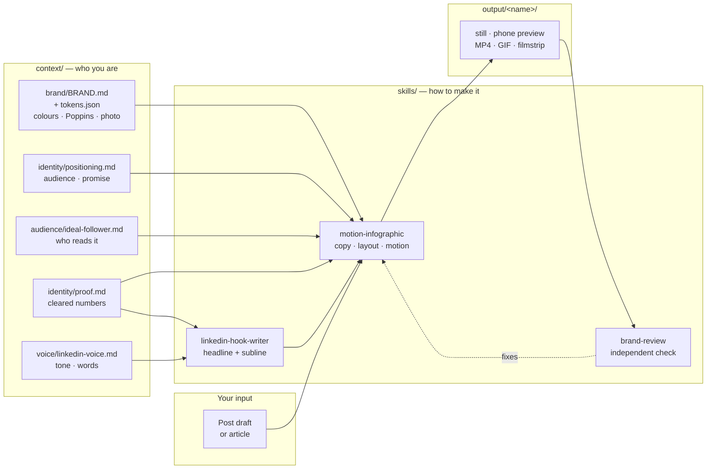

# linkedin-infographic-generator

By SaiSatish Vedam (Sai), Product Executive at productleadership.com.

Turn a LinkedIn post or an article into an **on-brand animated infographic**: a still, an MP4 and a GIF at 1080 × 1350. Each graphic is built with a coding agent (Claude Code or Codex) from Sai's own brand, proof and voice.

<p align="center">
  
</p>

<p align="center"><sub>This README as an animated system map, made with this project's map starter. <a href="docs/readme-infographic/output/scene@2x.png">Full-size still</a> · <a href="docs/readme-infographic/output/readme-infographic.mp4">MP4</a> · <a href="docs/readme-infographic/scene.js">Editable source</a></sub></p>

**Quick links:** [Set up](#set-up-once) · [Make a motion infographic](#make-a-motion-infographic) · [How context is used](#how-context-shapes-every-graphic) · [Use it for your own brand](#use-this-for-your-own-brand)

---

## What

A folder of **skills** (written procedures an agent follows), **starters** (ready-to-render animation projects) and **context** (Sai's brand, positioning, proof and voice). Ask the agent for a graphic and it reads the context, writes the copy, builds the animation as code, renders it, checks it, and hands you the files.

### What you get per graphic

| File | Size | Use it for |
|---|---|---|
| `scene.png` / `scene@2x.png` | 1080 × 1350 (4:5) | The fully built still: an image post, or the article's header image |
| `scene-phone.png` | 390 px wide | A check of how most people meet it in the feed |
| `<name>.mp4` | H.264, 1080 × 1350 | A LinkedIn video post (autoplays muted) |
| `<name>.gif` | 720 × 900, 15 fps, under 5 MB | A LinkedIn image post that animates and loops |
| `<name>-filmstrip.png` | 14 frames | Reviewing the build-in and the loop at a glance |
| `scene.js` + the folder | — | The editable source. Change a word and rebuild |

### The skills

| Skill | Role |
|---|---|
| [motion-infographic](skills/motion-infographic/SKILL.md) | **The main one.** A flat 2D animated infographic with icons that draw on, numbers that count up, bars that fill and a highlight that walks the rows. Two starters: **feed** (phone-readable) and **map** (a system-map poster with stages, icon cards, logo chips, connectors and decisions) |
| [linkedin-hook-writer](skills/linkedin-hook-writer/SKILL.md) | The headline and subline on the graphic, and the opening lines of the post that carries it |
| [brand-review](skills/brand-review/SKILL.md) | An independent review of a render: clarity, brand fit, export quality |
| [brand-system](skills/brand-system/SKILL.md) | Maintains the brand files and keeps every starter in sync with them |
| [graphics-designer](skills/graphics-designer/SKILL.md) | Static graphics and carousels. Also holds the copy rules every graphic follows |
| [diorama-3d](skills/diorama-3d/SKILL.md) | A 3D animated scene, for a system told as a place (a factory line, an office) |
| [flowchart](skills/flowchart/SKILL.md) | Editable Excalidraw process maps |

---

## Why

- **Motion earns the stop.** A graphic that builds in reading order (headline, then steps, then the number) gets read in that order. The motion explains the content; it isn't decoration.
- **The brand is enforced, not remembered.** Colours, Poppins, radii and the photo come from one token file. The Lemon Lime CTA is never text and never more than 10% of the canvas, and Turf Green stays the signal colour. Every graphic is consistent without anyone checking a style guide by hand.
- **Every number is defensible.** A number only appears if it's in [proof.md](context/identity/proof.md) or the cited source. The agent leaves a number out rather than inventing one. Your audience is product leaders, and one made-up stat costs more credibility than a graphic gains.
- **It sounds like you.** Headlines come from your own lines and your [voice](context/voice/linkedin-voice.md), not generic AI phrasing.
- **Code means repeatable.** The still, MP4 and GIF are rendered from the same `scene.js`, so they always match. Fix a typo and rebuild in about a minute. There are no design-tool exports to redo.
- **Checked before you see it.** An automatic layout check catches text outside the safe area, overlapping text and type too small for a phone. The agent then looks at the still, the phone preview and the filmstrip itself.
- **You stay in control.** Nothing is posted for you. A render is a draft until you post it.

---

## How context shapes every graphic



| Context file | What it decides on the graphic | Read by | Status |
|---|---|---|---|
| [brand/BRAND.md](context/brand/BRAND.md) + [tokens.json](context/brand/tokens.json) | Every colour, the font (Poppins only), corner radii, the CTA style, your photo, motion style | motion-infographic (`TOKENS`, `IMAGES` in the starter), diorama-3d, flowchart theme, brand-review | Adopted from your core design system. The LinkedIn sizes are **draft** |
| [identity/positioning.md](context/identity/positioning.md) | The angle: which takeaway fits your promise ("empower product professionals to lead and innovate") and the kicker or topic label | motion-infographic via graphics-designer's copy rules, hook-writer | Draft from your brand guide |
| [audience/ideal-follower.md](context/audience/ideal-follower.md) | Who it's for (PMs and product leaders), and so the vocabulary, level of detail and the subline | graphics-designer copy rules, hook-writer | Draft from your brand guide |
| [identity/proof.md](context/identity/proof.md) | **Which numbers may appear.** A counter, ring or bar shows only a cleared metric | motion-infographic, hook-writer, diorama-3d | **Empty.** Add numbers before using stats |
| [voice/linkedin-voice.md](context/voice/linkedin-voice.md) | Tone (professional, approachable, dependable), preferred words, what to avoid | linkedin-hook-writer, graphics-designer | Stated rules only. Add your own posts to confirm |
| [voice/formats.md](context/voice/formats.md) | Which graphic formats work for you, recorded over time | graphics-designer | Empty. It fills as you approve graphics |

**Rules the agent follows** ([context/AGENTS.md](context/AGENTS.md)):
- **Empty means unknown.** A page marked `stub` is a prompt, not a fact. The agent never invents your numbers, roles, quotes or opinions.
- **Your words first.** On a graphic for a post, the agent picks your own lines verbatim, in order, with their caveats, instead of rewriting them.
- **Draft vs adopted.** `adopted` brand rules are applied as they are. `draft` rules are applied but flagged, so you can confirm or change them.
- **One graphic doesn't change the brand.** Brand changes go through `brand-system`, which updates the guide, the tokens and both starters together.

---

## Set up (once)

You need Node 18+, ffmpeg (`brew install ffmpeg`) and Python 3.

```sh
npm install        # Playwright 1.58.2 and esbuild 0.24.0
npm run setup      # headless Chromium for rendering
npm run check      # project structure check + context lint
```

If `npm run setup` stalls on the Chromium download, render with your installed Google Chrome instead by putting `PW_CHANNEL=chrome` in front of any render command, e.g. `PW_CHANNEL=chrome ./make.sh`.

Open the project folder in Claude Code (or Codex). The skills are discovered automatically through `.claude/skills` and `.agents/skills`.

---

## Make a motion infographic

Each step shows **what to tell your agent**, then **what happens** underneath. You can do any step by hand instead.

### Pick your starting point

| You have… | Start with | The difference |
|---|---|---|
| **A LinkedIn post draft** | Path A | The graphic carries the post's main idea. Copy comes **verbatim** from your post |
| **An article or newsletter** | Path B | The graphic distils **one idea** from a longer piece and points back to it. More than one idea means a carousel or a series |

### Step 1: Brief

**Path A, from a post:**

```text
Use motion-infographic. Make an animated infographic for this LinkedIn post.
Keep my wording, use only numbers that are in the post or proof.md.
Before building, tell me the takeaway, the structure and the reading order.

<paste the post>
```

**Path B, from an article:**

```text
Use motion-infographic. Here is my article. Pick the one idea that works best
as a standalone infographic for product leaders, and tell me which idea you
picked and why. Use my sentences where possible and only numbers from the
article or proof.md. Before building, give me the takeaway, structure and
reading order. Add a CTA that points to the article.

<paste the article, or its file path or URL>
```

**What happens:**
- The agent reads `BRAND.md`, `positioning.md`, `ideal-follower.md`, `proof.md` and your voice page.
- It replies with a 3-line plan for you to approve or redirect:
  - **the one takeaway**
  - **the structure:** a sequence (steps), a comparison (before vs after), evidence (a stat), a hierarchy or a single thesis
  - **the reading order** the animation will follow
- It also lists the exact lines it will use, and flags any number that isn't cleared.

### Step 2: Headline

```text
Use linkedin-hook-writer for the graphic's headline and subline. Give me 3 options.
```

**What happens:** the agent writes headline and subline options in your voice, measures them, and recommends one. It runs `python3 skills/linkedin-hook-writer/scripts/check_hook.py`. On a graphic the headline should fit 2 lines at 64 px, roughly 40 characters a line. The same skill can write the opening lines of the post that carries the graphic.

### Step 3: Build

```text
Build it. Call it <short-name>.
```

**What happens:**

```sh
npm run new -- <short-name>          # feed starter: one takeaway, readable on a phone
npm run new -- <short-name> map      # map starter: a whole system or framework, a poster read at full size
```

The agent picks **feed** for a single takeaway from a post (at most about 6 rows, about 40 words). It picks **map** for a framework, a lead magnet or an article's model (3–5 stages, up to about 25 cards), and tells you which it chose and why.

The agent edits only `output/<short-name>/scene.js`:
- **`COPY`:** every word on the graphic, in one place, so it can be checked against your source.
- **Timing:** everything is on screen by about 2.5 s, then one gentle loop motion. The last 0.4 s fades back to empty, so the GIF restarts cleanly.
- **Layout:** the blocks your structure needs, built from the kit's helpers:
  - **Icons:** `icon` and `iconBadge`, 59 Lucide line icons that draw on stroke by stroke. Pick names from the [icon sheet](skills/motion-infographic/references/icons.png).
  - **Diagram parts:** `card` (icon, meta line, title, body, tags), `stage`, `connector`, `diamond`, `dotMatrix`.
  - **Logos and images:** `logoChip`, `logo` and `image`.
  - **Data and type:** `count`, `bar`, `ring`, and `richLine` for a highlighted headline word.
  A bar's length always matches its value, and a counter ends on the real number.
- **Brand:** already set in `brand.js` (copied from `skills/motion-infographic/kit/`): Poppins, Turf Green, the Lemon Lime CTA and your photo. Product logos come from `context/brand/assets/logos/`. Add one with `npm run logo -- <slug>`, and only for a product you actually use or discuss.

To watch it yourself, run `open output/<short-name>/scene.html` for a live preview in the browser. Add `?t=3` to the URL to freeze the frame at 3 seconds.

### Step 4: Render and check

```text
Render it and review the still, phone preview and filmstrip.
```

**What happens:**

```sh
cd output/<short-name> && ./make.sh  # still + layout check, frames, MP4, GIF, filmstrip
```

1. **Automatic layout check.** It looks for text outside the safe area, overlapping text, text crossing a card edge, and type too small for a phone (under 22 px source).
2. **The agent looks at the renders:**
   - `scene.png` at full size: hierarchy, spacing, line breaks, contrast
   - `scene-phone.png`: headline, numbers and CTA readable at feed size
   - the filmstrip: an empty first frame, the build in reading order, the loop and the fade
3. **It fixes the biggest weakness first** (hierarchy, then line breaks and spacing, then timing), re-renders and checks again.

It reports the real state: *source ready*, *rendered*, or *rendered and inspected*. A passing automatic check is not the same as a visual review.

### Step 5: Review and revise

```text
Use brand-review on output/<short-name>.
```

Then give your own feedback in plain words, for example "make the headline shorter", "swap rows 2 and 3", "the number is 64 not 72" or "no CTA on this one". The agent edits `scene.js` and re-renders. It keeps a short `README.md` in the asset folder with the brief, the copy source, each round of feedback and the rebuild command.

For the crisp final version, render at 2× scale:

```sh
./make.sh <short-name> 25 2
```

### Step 6: Post (you do this)

- **GIF** (`<name>.gif`): post it as an image. It animates and loops in the feed.
- **MP4** (`<name>.mp4`): post it as a video. It autoplays muted, so the graphic must work without sound, and it does.
- **Article:** use `scene.png` as the header or inline image, and the GIF or MP4 in the post that shares the article.
- **Post copy:** your post text stays yours. `linkedin-hook-writer` can tighten the opening lines.

Nothing is ever posted for you.

---

## Other formats

| Need | Ask for | Starter |
|---|---|---|
| A system map or framework poster (stages, icon cards, connectors, decisions) | `motion-infographic`, map starter | `npm run new -- <name> map`, then `./make.sh` |
| A 3D scene (a system as a place) | `diorama-3d` | `npm run new -- <name> diorama`, then `./build.sh`, `node capture.mjs frames 25`, `./encode.sh frames <name>` |
| A static graphic or carousel | `graphics-designer` | Built with HTML/CSS for the specific request |
| An editable process map | `flowchart` | `skills/flowchart/scripts/flowchart.py`, using `graphic.flowchartTheme` from `tokens.json` (Excalidraw has no Poppins) |

The quality bar for motion is [examples/reference/](examples/reference/manifest.json): a fast build, a clear reading order, labels readable on a phone and gentle looping motion. It is Tim Scheuer's artwork, so use it as a benchmark only, never as a style to copy.

---

## Keep your context current

| When… | Do this |
|---|---|
| You have a number to show | Add it to [proof.md](context/identity/proof.md) under "Cleared for public use", with its period and source |
| You've posted a few times | Paste 5–10 of your posts into [linkedin-voice.md](context/voice/linkedin-voice.md), so the stated tone is confirmed by real examples |
| You've seen a few graphics | Confirm or change the **draft** LinkedIn rules in [BRAND.md](context/brand/BRAND.md): doubled sizes, Forest for small green text, one loop motion |
| Your brand changes | Ask for `brand-system`. It updates `BRAND.md`, `tokens.json` and both starters together |
| A format works well | Record it in [formats.md](context/voice/formats.md) |

The brand source documents (core design system, brand voice guide, full-resolution portrait) are kept privately in a git-ignored `references/` folder and are not published. `BRAND.md` and `tokens.json` are the public record of the brand. Run `npm run check` after editing context.

---

## Use this for your own brand

Everything brand-specific is in a few files. To make it yours:

1. **Replace the brand source.** Put your design system or brand guide in `references/` (git-ignored, so it stays private), then ask your agent: *"Use brand-system to set up my brand from references/<your-kit>."* It rewrites `context/brand/BRAND.md` and `tokens.json`, `skills/motion-infographic/kit/brand.js`, and `skills/diorama-3d/starter/scene.css`.
2. **Fonts and photo.** Put licensed font files in `context/brand/assets/fonts/` and your photo in `context/brand/assets/`. Delete Sai's.
3. **Author line and logos.** Change `COPY.author` in both motion starters (`skills/motion-infographic/starters/*/scene.js`) and the footer in the diorama `scene.html`. Replace the logos in `context/brand/assets/logos/` with the tools you use (`npm run logo -- <slug>`).
4. **Context.** Reset `context/identity/`, `audience/` and `voice/` to your own sources. A page you haven't filled stays a `stub`, and the agent treats it as unknown.
5. Run `npm run check`.

Sai's photo, brand kit and brand assets are not covered by the MIT licence. Remove them before publishing a fork.

---

## Project layout

```text
linkedin-infographic-generator/
├── README.md · AGENTS.md (= CLAUDE.md) · LICENSE · THIRD_PARTY_NOTICES.md
├── package.json              npm run setup | new | check
├── skills/                   the 7 skills (+ catalog.json); .claude/skills and .agents/skills link here
│   └── motion-infographic/   kit/ (lib.js, icons.js, brand.js, render/capture/encode/make) · starters/feed · starters/map · references/icons.png
├── context/
│   ├── brand/                BRAND.md · tokens.json · assets/ (Poppins, sai-avatar.jpg, logos/)
│   ├── identity/             positioning.md · proof.md
│   ├── audience/             ideal-follower.md
│   ├── voice/                linkedin-voice.md · formats.md
│   └── index.md · log.md · AGENTS.md · templates/ · scripts/
├── references/               your private brand source files (git-ignored, not published)
├── docs/readme-infographic/  the infographic at the top of this README: source + GIF, MP4, stills (committed)
├── examples/reference/       1 quality-bar GIF
├── scripts/                  new.sh · build-icons.mjs · add-logo.mjs · check-template.py
└── output/                   one folder per graphic (ignored by git)
```

## Commands used by Skills

| Command | Does |
|---|---|
| `npm run new -- <name> [feed\|map\|diorama]` | Starts a graphic in `output/<name>/` (default: feed) |
| `npm run icons` | Rebuilds `kit/icons.js` after you add a Lucide icon name to `scripts/build-icons.mjs` |
| `npm run logo -- <slug> [brand\|ink\|#hex]` | Adds a Simple Icons logo to `context/brand/assets/logos/` and records it in `logos.json` |
| `./make.sh [name] [fps] [scale]` | In a motion folder: still + check, frames, MP4, GIF, filmstrip |
| `node render.mjs [--strict]` | Still and phone preview only; `--strict` fails on layout warnings |
| `node capture.mjs frames [fps] [scale]` | Frames only |
| `./encode.sh frames <name> [fps] [gif-fps] [gif-width]` | MP4, GIF and filmstrip from captured frames |
| `npm run check` | Project structure + context lint (run before committing) |

## Troubleshooting

| Symptom | Fix |
|---|---|
| `npm run setup` hangs on the download | Use `PW_CHANNEL=chrome` with your installed Google Chrome |
| Render fails on a font | A file in `context/brand/assets/fonts/` is missing or renamed. This is deliberate: there's no silent fallback |
| "image missing" note | The photo path in `IMAGES` is wrong. The graphic falls back to initials |
| Layout warnings | Shorten the copy first, then adjust spacing. Don't shrink text below 22 px |
| GIF over 5 MB | `./encode.sh frames <name> 25 12 640`, or simplify the background |

## Credits and licence

Cut down from [LinkedIn Funnel](https://github.com/timscheuerai/linkedin-funnel) by Tim Scheuer (MIT), which includes adapted content-vault skills (Oxygen, MIT). `motion-infographic` is new here, adapted from that template's canvas explainer renderer. three.js is vendored under MIT. Icons are from Lucide (ISC). Logo artwork is from Simple Icons (CC0), and the marks remain their owners' trademarks. Poppins is under the SIL Open Font License. Details are in [LICENSE](LICENSE) and [THIRD_PARTY_NOTICES.md](THIRD_PARTY_NOTICES.md).
